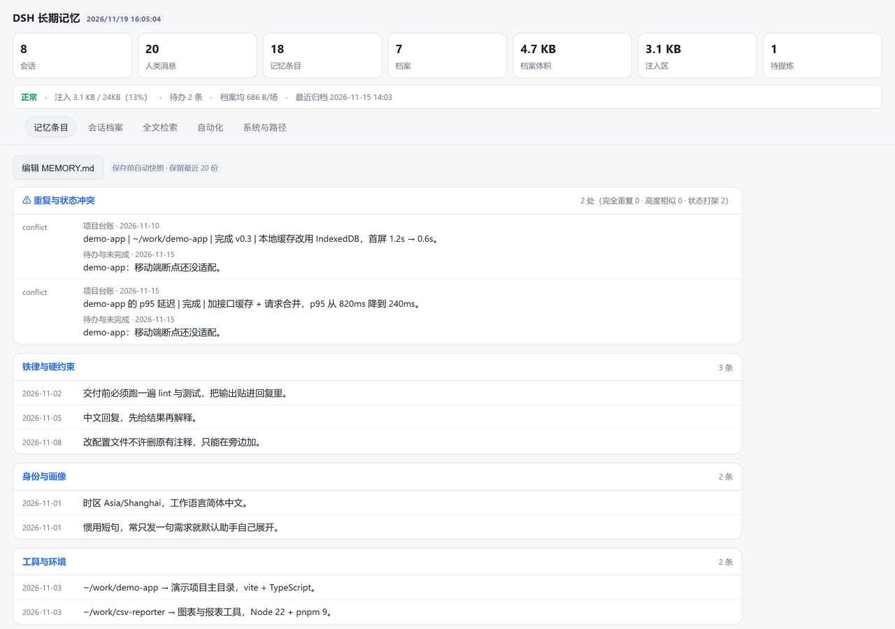
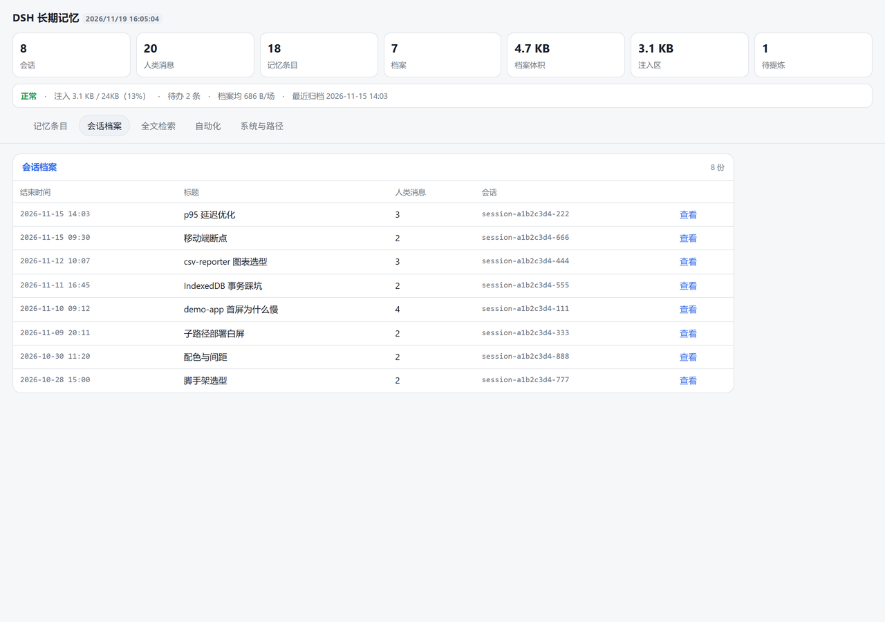
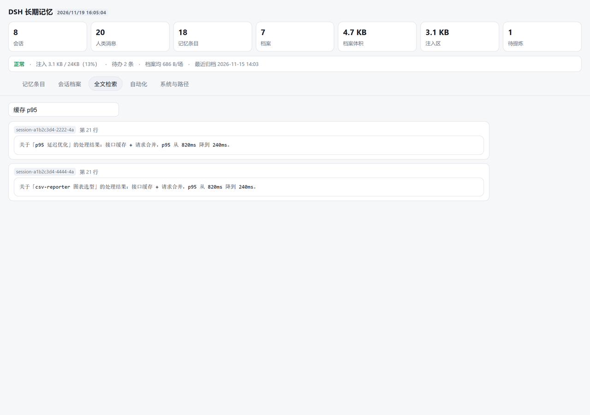
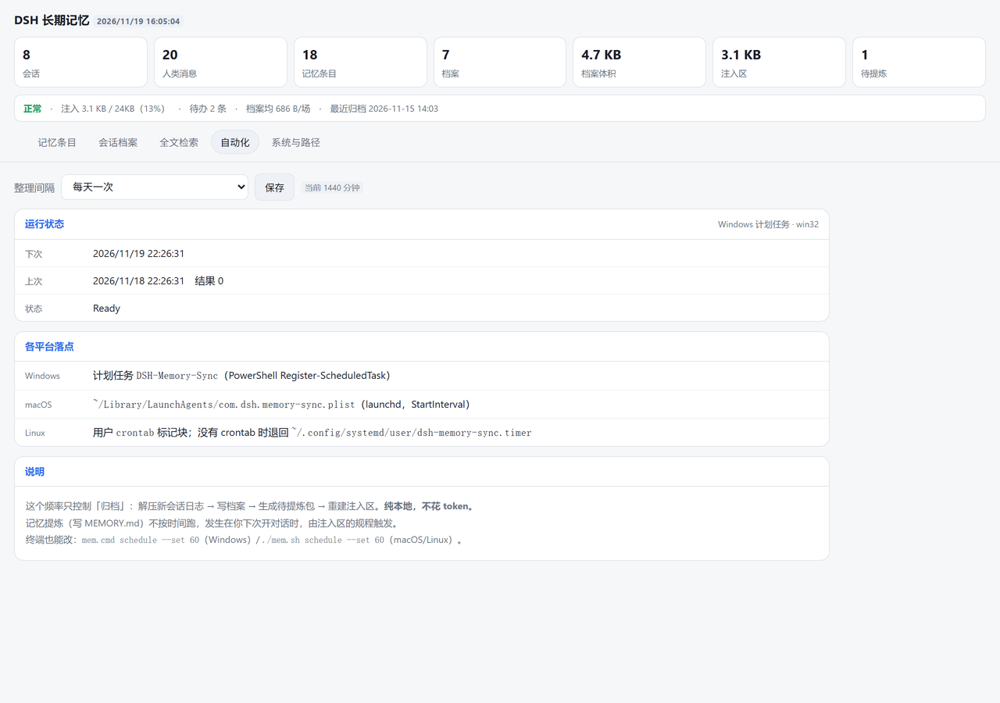

# DSH 记忆套件 v1.0.0

给 [DeepSeek Harness](https://github.com/deepseek-ai/deepseek-harness) 加一套**长期记忆**：把历史会话自动归档、提炼成一份能长期复用的记忆库，并在每次新对话开头自动注入。

附带一个可视化面板（设置 → 记忆），能看条目、翻档案、全文检索、改记忆、调归档频率。

> **这个包不含任何个人数据。** 记忆主库是空模板，归档目录为空，没有任何作者本人的会话、路径或身份信息。详见「隐私」一节。

## 面板长什么样

> 截图来自一份**演示数据**：人名、项目、路径全是虚构的（`~/work/demo-app`、`csv-reporter`），不是任何人的真实记忆。

| 记忆条目（顶部是重复/冲突检测） | 会话档案（8 场，含已压缩的上月档） |
|---|---|
|  |  |

| 全文检索（中文分词） | 自动化（归档频率三平台） |
|---|---|
|  |  |

---

---

## 它解决什么问题

AI 每次开新对话都是失忆的：昨天定下的风格、上周踩过的坑、上个月的项目状态，全要重说一遍。

这套东西把「说过的」变成「默认就知道的」：

```
会话日志 ──(定时归档)──▶ 档案 + 增量包 ──(提炼)──▶ MEMORY.md ──(注入)──▶ 每个新会话
                            │                                  │
                            └────── /memory-panel 面板 ◀────────┘
```

三层各管一段：

| 层 | 谁干 | 频率 | 花钱吗 |
|---|---|---|---|
| 采集归档 | 系统调度器（计划任务 / launchd / cron） | 自定，默认 3 小时 | 不花 |
| 提炼合并 | AI，在你下次开对话时做 | 有积压才做 | 花一点 |
| 注入 | DSH 自己，每个新会话首轮 | 自动 | 计入上下文 |

---

## 前置条件

- 已安装并启动过一次 **DeepSeek Harness**（需要 `~/.dsh` 目录和 profile）
- Windows 10/11、macOS 或 Linux
- 不需要额外装 Node：优先用 DSH 内置运行时，找不到才用 PATH 里的 `node`（需 ≥ 18，推荐 ≥ 22，因为要用到 `zlib.zstdDecompressSync`）

---

## 安装

### Windows

```powershell
cd dsh-memory-kit-1.0.0
.\install.ps1                       # 装到 %USERPROFILE%\.dsh，默认每 3 小时归档
.\install.ps1 -IntervalMinutes 60   # 每小时
.\install.ps1 -NoSchedule           # 只装文件，不装计划任务
```

如果 PowerShell 拦脚本：

```powershell
powershell -NoProfile -ExecutionPolicy Bypass -File .\install.ps1
```

### macOS / Linux

```sh
cd dsh-memory-kit-1.0.0
chmod +x install.sh
./install.sh                 # 默认每 3 小时
./install.sh --interval 60   # 每小时
./install.sh --no-schedule   # 不装调度
```

macOS 装 `~/Library/LaunchAgents/com.dsh.memory-sync.plist`；Linux 写用户 `crontab` 标记块，没有 `crontab` 时退回 `~/.config/systemd/user/dsh-memory-sync.timer`。

### 装完

1. **重启 DSH**（插件在 profile 启动时装载）
2. 打开 **设置 → 记忆**，或直接访问 `http://127.0.0.1:<端口>/memory-panel/`
3. 先正常聊几轮，然后点面板里的「立即归档新会话」——你会看到档案和待提炼包出现

---

## 面板里有什么

| 标签页 | 内容 |
|---|---|
| 记忆条目 | 按 `MEMORY.md` 分节展示；顶部「编辑 MEMORY.md」可直接改，保存前自动快照（保留 20 份，可回滚）；有重复/冲突会单独列出来 |
| 会话档案 | 按时间倒序，点「查看」展开原文；旧月份已压缩成 `.gz`，照样能看 |
| 全文检索 | 中文按 bigram 分词，「控件」能命中「控件版」；英文按词 |
| 自动化 | 归档频率（15 分钟 ~ 1 天）、下次/上次运行、各平台落点说明 |
| 系统与路径 | 立即归档、重建注入区、压缩旧月份、各文件的实际路径 |

顶部健康条只报**能动手**的事：待提炼包积压 ≥3 天、注入接近预算（24KB 的 80%）、从没归档过、有完全重复条目。

---

## 命令行

```bat
:: Windows
%USERPROFILE%\.dsh\mem.cmd status
%USERPROFILE%\.dsh\mem.cmd sync
%USERPROFILE%\.dsh\mem.cmd search 关键词
%USERPROFILE%\.dsh\mem.cmd schedule --set 60
```

```sh
# macOS / Linux
~/.dsh/mem.sh status
~/.dsh/mem.sh sync
~/.dsh/mem.sh search 关键词
~/.dsh/mem.sh schedule --set 60
```

| 子命令 | 作用 |
|---|---|
| `ingest` | 扫描会话日志 → 写档案 + 增量包（纯本地） |
| `sync` | `ingest` + 滚动压缩 + 重建注入区 + 刷新离线快照 |
| `search <词>` | 在全部档案里检索（自动解压旧月份） |
| `show <会话id前缀>` | 看某场会话档案 |
| `compact` | 把非当月档案并成 `.gz` |
| `schedule [--set N]` | 查/改归档频率（三平台同一套输出） |
| `status` | 统计 |
| `render` | 用 `MEMORY.md` 重建 `~/.dsh/AGENTS.md` 的注入区 |

---

## 目录结构（安装后）

```
~/.dsh/
├─ AGENTS.md                 ← 注入区（托管段落由工具生成，别手改）
├─ mem.cmd / mem.sh          ← 命令行入口
├─ plugins/dsh-memory-panel/ ← 插件本体
└─ memory/
   ├─ MEMORY.md              ← 记忆主库（唯一真源，人工可编辑）
   ├─ archive/               ← 会话档案：当月散装 .md，旧月份 .md.gz
   ├─ monthly/               ← 月度摘要
   ├─ backups/               ← MEMORY.md 快照（20 份）
   ├─ inbox/                 ← 待提炼增量包（提炼完自动删）
   ├─ journal/               ← 边聊边记的流水
   ├─ state.json             ← 增量指纹（哪些会话已归档）
   ├─ config.json            ← 归档频率记录
   └─ dashboard.html         ← 离线可视化快照
```

---

## 隐私

**这个安装包不含任何个人数据**，具体保证：

- `memory/MEMORY.md` 只有空模板（8 个小节标题 + 一句格式说明，零条目）
- `memory/archive`、`journal`、`inbox`、`backups`、`monthly` 全为空目录
- 插件代码里没有任何硬编码的用户路径、用户名或会话内容，全部走 `$DSH_HOME` / `process.env`
- 不含作者的 `AGENTS.md`、`config.json`、`state.json`、`dashboard.html`

**装好之后，数据只在你本机：**

- 所有文件都在 `~/.dsh` 下，不上传任何地方
- 面板只绑 `127.0.0.1`（沿用 DSH 自己的监听地址），同机其他程序理论上可读——这是本机信任模型
- 归档与注入**不调用模型、不花 token**；只有「提炼」这一步用模型，且发生在你自己的对话里
- 记忆里写什么由你决定；密码、密钥、身份证号这类别写进 `MEMORY.md`

**卸载**：

```powershell
.\install.ps1 -Uninstall      # 记忆数据会改名保留为 memory.bak-<时间戳>
```
```sh
./install.sh --uninstall
```

---

## 常见问题

**设置里没有「记忆」**
重启过 DSH 吗？`install.ps1` 是否报 profile 找不到？装好并启动过一次 DSH 再装本套件。

**面板打不开 / 404**
`~/.dsh/AGENTS.md` 里没内容说明 render 没跑过；先 `mem.cmd sync`。面板 404 通常是插件没装载——看 DSH 启动日志里有没有 `dsh-memory-panel`。

**归档没跑**
`mem.cmd schedule` 看状态；Windows 看任务计划程序里的 `DSH-Memory-Sync`，Linux 看 `crontab -l`，macOS 看 `launchctl list | grep dsh`。

**注入太大**
`MEMORY.md` 超过 24KB 会被截断注入。把细节挪到 `journal/`，主库只留结论。

**中文搜不到**
检索是 bigram，靠字面相邻。换个说法、或用更短的关键词。

---

## 卸载干净

`-Uninstall` / `--uninstall` 会：移除 profile 里的 bundle 与依赖、删掉 node_modules 链接、删插件目录、删调度项、把 `memory/` 改名保留。确认不要数据后再手动删那个 `.bak` 目录。

---

## 许可

MIT。插件与工具均为纯本地实现，无网络请求（除你自己使用 AI 时的正常对话）。
